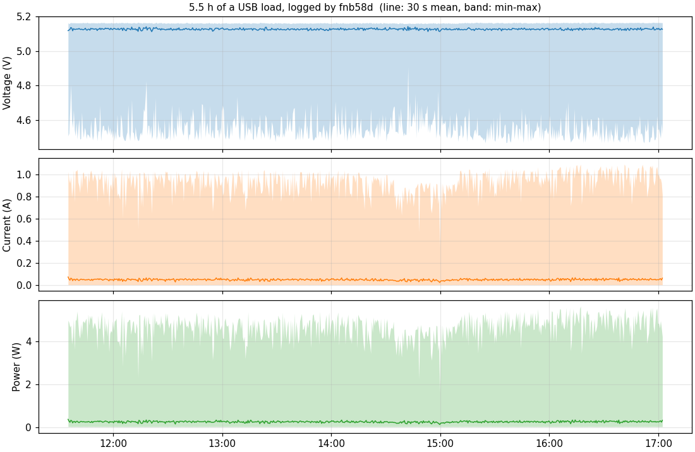
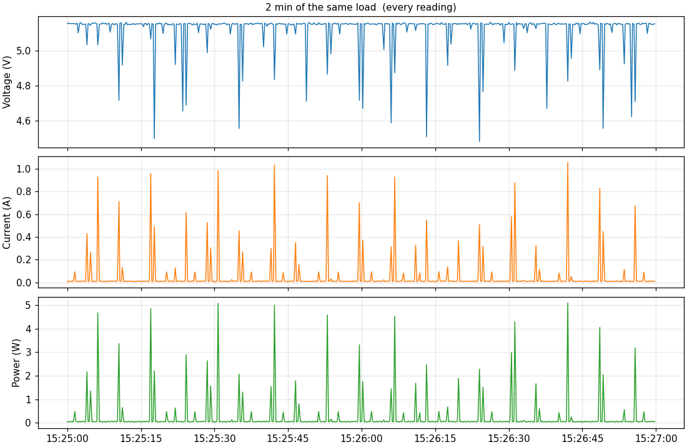

# fnb58-ble-logger

[](https://github.com/melnykai/fnb58-ble-logger/actions/workflows/ci.yml)

A Linux daemon that reads an **FNIRSI FNB58** USB power tester over **Bluetooth LE** and logs
voltage, current and power to one CSV file per day. It runs unattended under systemd, and it
reconnects by itself when the tester is switched off, replugged or out of range.

The tester's Bluetooth protocol is not documented. It was reverse-engineered for this project, see
[docs/protocol.md](docs/protocol.md). The repo is also a worked example of
[OpenSpec](https://openspec.dev/): a specification written after the fact, then a change written
before any code. [docs/development-story.md](docs/development-story.md) tells how it was built.

```
2026-11-03T10:58:08.642+0100,1793699888.642,4.6012,2.5038,11.5209
2026-11-03T10:58:08.820+0100,1793699888.820,4.6013,2.5038,11.5209
```

A real session: 5 h 27 min of a bursty USB load, 78,512 readings at 4 per second, no gap. The
load idles near 10 mA and draws 0.4–1 A for a single reading every few seconds:




Both plots come from `tools/plot_csv.py`.

## Quick start

Needs Linux with BlueZ, `cmake` ≥ 3.16, a C compiler and `libglib2.0-dev`. The BLE library is
vendored, so the build needs no network access.

```sh
sudo apt install cmake build-essential libglib2.0-dev
cmake -S . -B build && cmake --build build -j
ctest --test-dir build                 # parser test on real captured frames
./build/fnb58d -o ~/fnb58 -v           # turn the tester on, enable its Bluetooth
```

Today's readings are in `~/fnb58/<YYYY-MM-DD>_fnb58.csv`. Stop with Ctrl+C. To plot them
(needs `python3-matplotlib`):

```sh
python3 tools/plot_csv.py ~/fnb58/*_fnb58.csv -o day.png                  # 10 s bins
python3 tools/plot_csv.py ~/fnb58/*_fnb58.csv -b 0 -s 15:25 -d 120 -o zoom.png  # raw window
```

### As a service

```sh
sudo install -m 755 build/fnb58d /usr/local/bin/
sudo install -m 644 systemd/fnb58d.service /etc/systemd/system/
sudo systemctl daemon-reload && sudo systemctl enable --now fnb58d
journalctl -u fnb58d -f                # events only; readings are in /var/lib/fnb58d/
```

Pin a specific tester with `FNB58D_OPTS="-a AA:BB:CC:DD:EE:FF"` in `/etc/default/fnb58d`.

## Options

| Option | Default | Meaning |
|---|---|---|
| `-a, --address MAC` | match by name | connect only to this tester |
| `-n, --name NAME` | `FNB58` | name prefix to scan for |
| `-o, --dir DIR` | `.` | CSV directory (the unit uses `/var/lib/fnb58d`) |
| `-w, --watchdog N` | 10 | seconds without a reading before reconnecting (min 2) |
| `-k, --keep-days N` | 14 | delete CSV files older than N days; 0 keeps all |
| `-r, --raw` | off | also log every raw frame, all types, as hex |
| `-v, --verbose` | off | debug messages, including the BLE library |
| `-u, --udp HOST:PORT` | off | also send each measurement as one JSON datagram; `[IPv6]:PORT` works |

### Live stream

With `--udp`, every line written to the CSV is also sent as one UDP datagram of JSON, same values
and decimals:

```json
{"epoch_s":1793699888.642,"voltage_v":5.1613,"current_a":0.1054,"power_w":0.5442}
```

```sh
./build/fnb58d -o ~/fnb58 --udp 127.0.0.1:5005
nc -ul 5005                                # one JSON line per measurement
```

```python
import json, socket
s = socket.socket(socket.AF_INET, socket.SOCK_DGRAM)
s.bind(("0.0.0.0", 5005))
while True:
    m = json.loads(s.recv(256))
    print(f'{m["voltage_v"]:.3f} V  {m["current_a"]:.3f} A')
```

The CSV stays the record: sending never blocks, lost datagrams are not re-sent, and failed sends are
reported as one `udp: <n> send errors` line per minute at most. A bad or unresolvable address stops
the daemon at start with exit code 2. The stream is neither authenticated nor encrypted; send it to
localhost or a trusted network only.

## How it works

```
FNB58 ──BLE──> bluetoothd (BlueZ) ──D-Bus──> bluez_inc ──callbacks──> fnb58d ──> <day>_fnb58.csv
                                                                          ├─────> journal (events)
                                                                          └─────> UDP JSON (--udp, optional)
```

- **Connect:** scan by name or address, connect, write `aa8100f4` then `aa8200a7` to `ffe9`, and
  subscribe to `ffe4`.
- **Parse:** rebuild frames `AA type len payload check` across notifications, and decode type `04`
  into V, A and W.
- **Recover:** a lost link, 10 s without a reading, or 30 s connected with no data → forget the device
  and rescan. Rescans back off from 1 s to 30 s.
- **Store:** CSV flushed every 1 s, a new file at midnight, files deleted after 14 days.

The full behaviour, with scenarios, is the spec:
[openspec/specs/fnb58-ble-logger/spec.md](openspec/specs/fnb58-ble-logger/spec.md).

## OpenSpec in this repo

```
openspec/
├── config.yaml                      project context and rules for every artifact
├── specs/fnb58-ble-logger/spec.md   current behaviour: 10 requirements (source of truth)
└── changes/
    ├── archive/2026-11-03-add-fnb58-ble-logger/   baseline, post-factum, archived
    └── add-udp-live-stream/                       spec-first, proposed, not implemented
```

The loop, as used here:

```sh
openspec list                                   # open changes and their task counts
openspec show add-udp-live-stream               # read a proposal
openspec validate --all --strict                # what CI runs on every push
# implement the tasks, tick them in tasks.md, then:
openspec archive add-udp-live-stream --yes      # merges the delta into specs/
```

- **Every requirement ends with a `Verify:` line:**
  - `test:<name>`: a `ctest` test;
  - `hardware`: needs a real tester;
  - `review`: checked by reading the code.
- **Rules:** `openspec/config.yaml` holds the rules that agents and people follow when writing
  artifacts.
- **Claude Code commands:** `openspec init` added the `/opsx:*` commands in `.claude/`, so a coding
  agent can propose, apply and archive changes with the same workflow.

## Status

| Area | State |
|---|---|
| Discovery, stream start, decoding | verified on hardware and by unit test |
| CSV writing, restart, raw frames | verified on hardware |
| Recovery from a lost link | verified on hardware: tester off for 58 s, streaming 2 s after it came back |
| Silent-link watchdog, 60 s scan restart | implemented, **not yet triggered on hardware** |
| Long runs | verified on hardware: 5 h 27 min under systemd, 78,512 readings, no gap; 12 h or more **not run yet** |
| Unit as shipped (`DynamicUser`) | **not run yet**; the daemon was run as a service under a regular user |
| Frame types `05`–`08`, check byte | unknown, see [docs/protocol.md](docs/protocol.md) |
| Live UDP stream | implemented; formatting, addresses and non-blocking sends verified by unit test; **not yet run with a tester** |

Tested on Ubuntu 26.04 with BlueZ and an Intel laptop adapter.

## Repository map

| Path | Content |
|---|---|
| `src/fnb58d.c` | daemon: options, state machine, CSV, watchdogs, journal |
| `src/fnb58_proto.{h,c}` | frame parser and decoding, plain C |
| `src/udp_out.{h,c}` | live UDP stream: JSON formatting, non-blocking send, plain C |
| `tests/test_proto.c` | parser test on captured notifications |
| `tests/test_udp_out.c` | stream test: exact bytes, addresses, sends to a closed port |
| `systemd/fnb58d.service` | service unit |
| `tools/fnb58_ble.py` | Python prototype (bleak), used to find the protocol |
| `tools/plot_csv.py` | plot CSV files: binned overview or raw window (matplotlib) |
| `third_party/bluez_inc/` | [weliem/bluez_inc](https://github.com/weliem/bluez_inc) 157c604, MIT, unmodified |
| `openspec/` | specs and changes |
| `docs/` | protocol notes and development story |

## License

MIT, see [LICENSE](LICENSE). `third_party/bluez_inc` is MIT, © Martijn van Welie.
FNIRSI and FNB58 are trademarks of their owner; this project is not affiliated with them.
